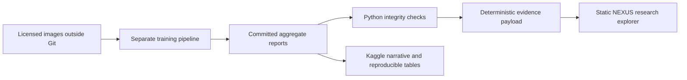

# NEXUS / APTOS research portfolio

**[Published research explorer](https://senanurcetin.github.io/APTOS-2019-diabetic-retinopathy/)**

## Review the evidence

The central question is whether a high in-distribution score transfers across
acquisition settings and grading standards. This is a noncommercial, English-first
research portfolio for data scientists, research engineers and technical reviewers.
No subscriptions, payment integration or patient-facing service is part of its scope.

The static explorer reads only committed aggregate reports. It compares original
grade thresholds with a separately selected referral operating point; it also shows
per-grade recall, model variation and source hashes. Neither decision transfers
reliably to Messidor-2. The page deliberately has no image upload or model dependency.

```bash
pip install -e ".[dev]"
python -m aptos.reporting.portfolio
python -m aptos.reporting.portfolio --check
python -m http.server 8080 --directory serving/static
# Open http://localhost:8080/research.html
```

The existing FastAPI demonstration also serves `/static/research.html`. Static
hosting can publish the contents of `serving/static` without a custom domain,
database, server, GPU, account or paid API. Hosting configuration is separate from
the generated artifact; a local build does not verify a deployed release.

The repository now publishes the explorer through GitHub Pages using
`.github/workflows/research-pages.yml`. Only the explorer, its CSS/JavaScript
and official identity assets are uploaded. The inference demonstration and model
weights are excluded. The public URL returned HTTP 200 with generated evidence
on 24 October 2026. [Successful deployment](https://github.com/senanurcetin/APTOS-2019-diabetic-retinopathy/actions/runs/40027466025).

## Delivery verification — 24 October 2026

- [GitHub validation](https://github.com/senanurcetin/APTOS-2019-diabetic-retinopathy/actions/runs/40027233287):
  Python 3.10/3.11/3.12 pure tests, full CPU tests with coverage and Ruff succeeded.
- Local focused evidence/identity/operating-point checks: 23 passed.
- Node VM verification: both cohort selections rendered the expected counts,
  sensitivities and grade recalls without browser automation.
- A separate local Kaggle-staging test cannot create directory symlinks without
  Windows privilege (WinError 1314); Linux CI passed that contract. No system
  permission was changed to work around it.
- Kaggle public narrative version 6 was uploaded and its source read back exactly.
  At this verification point its CPU execution was still RUNNING. Source upload
  and source parity do not establish successful execution. Earlier version 5
  reported COMPLETE before the final lint-only publication revision.
- No new imaging-model performance is claimed. The existing separate GPU
  `aptos-research-reg-seed42` reported COMPLETE, but all five fold result artifacts
  were not audited in this delivery.
- Playwright was excluded from the final verification. Earlier screenshot
  capture attempts timed out; responsive visual acceptance is not claimed.

## Architecture and source contracts



- `src/aptos/reporting/portfolio.py`: report validation and deterministic build.
- `serving/static/research.template.html`: research narrative and accessible sections.
- `serving/static/research.html`: generated payload embedded for local/offline use.
- `serving/static/research.css`, `research.js`: responsive identity and cohort controls.
- `notebooks/kaggle_publication/`: versioned copy of the existing Kaggle narrative.
- `reports/`: historical results; underlying images and weights remain separate.

Official NEXUS Identity 2.0 wordmark and icon are retained byte-for-byte. Palette:
midnight, cyan, blue, lavender and violet. The source was checked in Drive's
`Logo/NEXUS_Identity_2_0` folder on 23 October 2026; see
[identity provenance](nexus-clinical-research.md).

## Interpretation boundaries

- The best recorded ensemble QWK (0.9098) and the externally evaluated baseline
  (APTOS test QWK 0.9091) are different experiments. Do not mix model versions.
- Grade ≥ 2 uses a score cut around 1.132; the selected referral operating point
  uses 1.3359375. IDRiD sensitivity is respectively 88.5% and 81.6%; Messidor-2
  sensitivity is respectively 32.8% and 26.0%.
- Five fold models scored on one shared test set do not provide five independent
  test cohorts. Repeated inspection of that test set weakens confirmatory claims.
- Wilson intervals are descriptive, without adjustment for bilateral patient clusters.
- Aggregate reports cannot establish causal attribution to labels or cameras.
- Duplicate-pair label discordance is not a formal population accuracy ceiling.
- No new training result is implied by restyling or recomputing aggregate tables.

## Zero-cost operating plan

The explorer requires static bytes only. Its maintenance has no recurring service
cost. Kaggle CPU publication and GPU experiments are separate: use CPU for the
narrative, run one GPU experiment at a time and stop when quota is unavailable.
Do not enable paid accelerators or external paid APIs. No numeric free-tier quota
is assumed because availability is account-dependent and can change.

When reports change, regenerate the page and run its stale-artifact test. When
datasets or weights grow, keep them outside Git; publish authorized model artifacts
separately with hashes. When training limits are reached, reduce the experiment
matrix or defer runs. Additional infrastructure is not needed to scale the static
portfolio. Professional value comes from reviewable methods and evidence; direct
monetization is intentionally excluded by this project's noncommercial scope.
