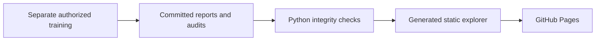

# NEXUS research explorer

**[Published explorer](https://senanurcetin.github.io/APTOS-2019-diabetic-retinopathy/)**

The explorer presents committed aggregate evidence for research reviewers.
It compares external cohorts, distinguishes original grade thresholds from a
separately selected referral rule, and shows the completed examination-disjoint
follow-up together with its APTOS retention loss. It needs no image upload,
account, database or model inference.

## Build and serve

```bash
python -m pip install -e ".[dev]"
python -m aptos.reporting.portfolio --check
python -m http.server 8080 --directory serving/static
# Open http://localhost:8080/research.html
```

Regenerate with `python -m aptos.reporting.portfolio` after intentionally updating
inputs or the template. Use committed LF evidence bytes for identical hashes
across platforms. The builder validates reports and requires a successful
follow-up audit matching the result fingerprint.



| Component | Responsibility |
|---|---|
| `src/aptos/reporting/portfolio.py` | Validate evidence and render payload |
| `serving/static/research.template.html` | Narrative and semantic page structure |
| `serving/static/research.html` | Generated page with embedded aggregate evidence |
| `serving/static/research.css`, `research.js` | Responsive styling and cohort controls |
| `.github/workflows/research-pages.yml` | Publish explorer assets as a static site |

Pages publishes only the explorer, CSS/JavaScript and identity assets. The
inference illustration remains separate. Pages serves the explorer as
`index.html`; locally the file is `research.html`.

## Official NEXUS identity

The SVG wordmark and X/favicon come from Drive's approved
[`Logo/NEXUS_Identity_2_0` folder](https://drive.google.com/drive/folders/1rU3QCrdwCdHB0tYVLIq0W6aPqpj3iOsY).
They were checked against the originals on 23 October 2026. The source assets
are `serving/static/nexus-logo.svg` and `serving/static/nexus-x.svg`.

| Asset | Recorded Git blob object ID |
|---|---|
| Wordmark | `7913f5155f6620ed771a602db409cf428a347c94` |
| X mark | `5872cf6339bc31f4c11f2699779a9f3e582f9d64` |

The palette uses midnight `#0B0F19`, deep blue `#061524`, cyan `#00E0FF`,
blue `#4EA8FF`, lavender `#8F9BFF`, violet `#6E55C6` and slate `#B9C5CE`.
The evidence and GPU notebooks embed the official wordmark as an SVG attachment
for offline portability. Styling does not alter numerical source evidence.

The separate inference page uses `nexus-theme.css`; the explorer uses
`research.css`. The [Figma brand source](https://www.figma.com/design/oA9wyvurYfypG4onVoa4pS)
is a design reference, not a runtime dependency.

## Verification and boundaries

The [completion record](../reports/research/messidor2_v2_completion.json) pins
successful CI, public Kaggle v10 execution, live HTML/CSS/JS/logo source parity
and Node VM rendering checks. No desktop/mobile pixel-rendering acceptance is
claimed; PC-screen access and Playwright were excluded by instruction.

The historical baseline, newer scalar sweep and fine-tuned arms are distinct.
The [scientific review](SCIENTIFIC_REVIEW.md) is authoritative for interpretation;
the [v2 results](../reports/research/messidor2_v2_results.md) document the gain,
retention loss, rare-grade limitations and remaining provenance uncertainty.

Static delivery has no recurring service requirement or custom-domain dependency.
Training is separate and limited to available free quota. Monetization and
commercial deployment are outside this project's noncommercial scope.
